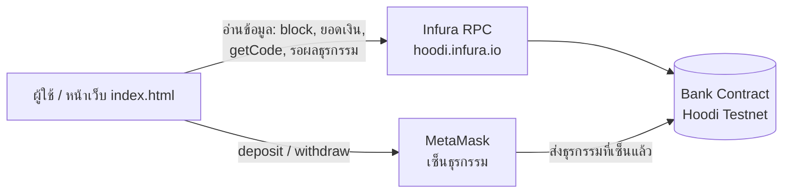

# 🏦 Bank DApp × Infura

เว็บแอปพลิเคชันแบบกระจายศูนย์ (DApp) สำหรับ **ฝากเงิน / ถอนเงิน / ตรวจสอบยอดเงิน** ผ่าน Smart Contract บน Ethereum Testnet
เวอร์ชันนี้ **อ่านข้อมูลจาก blockchain ผ่าน Infura RPC** และ **ใช้ MetaMask เฉพาะตอนเซ็นธุรกรรม** (ฝาก / ถอน)

🔗 **เว็บไซต์:** https://thanapoomwi.github.io/bank-dappInfura/

| | |
|---|---|
| ผู้จัดทำ | ธนภูมิ วิธานกรกุล (Tanapoom Witrankronkoon) |
| รหัสนักศึกษา | 66068660 |
| Network | Hoodi Testnet (Chain ID `560048`) |
| RPC Provider | Infura (`https://hoodi.infura.io/v3/<API_KEY>`) |
| Contract Address | `0xFeC3b089CDc3da263D529a9BFb2daC1c92d272Fb` |
| ดู Contract บน Explorer | https://hoodi.etherscan.io/address/0xFeC3b089CDc3da263D529a9BFb2daC1c92d272Fb |

---

## 🧭 ระบบทำงานอย่างไร



| งาน | ทำผ่าน | เหตุผล |
|---|---|---|
| เช็กว่า contract มีอยู่จริง (`getCode`) | Infura | ไม่ต้องพึ่ง network ที่เลือกใน MetaMask |
| แสดงเลข block ล่าสุด (อัปเดตทุก 12 วินาที) | Infura | แสดงสถานะการเชื่อมต่อ |
| ดูยอดเงินในธนาคาร (`checkBlance`) และยอด ETH ในกระเป๋า | Infura | เป็นการอ่านข้อมูล ไม่เสีย gas |
| ฝาก / ถอนเงิน | MetaMask | ต้องใช้ private key เซ็นธุรกรรม ซึ่งอยู่ใน MetaMask เท่านั้น |
| รอให้ธุรกรรมยืนยัน (`waitForTransaction`) | Infura | ติดตามผลธุรกรรมจาก RPC ของเราเอง |

> 💡 Infura ไม่รู้ว่าใครเป็นผู้ใช้ ดังนั้นตอนเรียก `checkBlance()` ซึ่งอ่านยอดของ `msg.sender` โค้ดจึงส่ง `{ from: account }` ไปด้วย เพื่อให้ได้ยอดของบัญชี MetaMask ที่เชื่อมต่ออยู่

---

## ✅ สิ่งที่ต้องมีก่อนเริ่ม

1. **เบราว์เซอร์ที่ติดตั้ง MetaMask** — https://metamask.io/download/
2. **ETH บน Hoodi Testnet** — ขอฟรีจาก Hoodi faucet (ใช้จ่ายค่า gas และใช้ฝาก)
3. **Infura API Key** — ดูขั้นตอนด้านล่าง (ถ้าแค่ใช้งานเว็บที่ deploy ไว้แล้ว ข้ามขั้นนี้ได้)

---

## 🔑 ตั้งค่า Infura (สำหรับนำโปรเจกต์ไปรันเอง)

1. เข้า https://developer.metamask.io (Infura ย้ายมาอยู่ในหน้านี้) แล้วสมัคร / ล็อกอิน
2. กด **Create new API key** แล้วตั้งชื่อ เช่น `bank-dapp`
3. ในหน้าตั้งค่า API key ไปที่ส่วน **Endpoints / Networks** → เปิด **Ethereum → Hoodi** (ถ้าจะใช้ Sepolia ก็เปิด Sepolia ด้วย) แล้วกด Save
4. คัดลอก **API Key** มาเก็บไว้
5. *(แนะนำ)* ที่ส่วน **Allowlists** ของ API key ให้เพิ่ม origin ของเว็บ เช่น `thanapoomwi.github.io` และ `localhost` เพื่อให้คนอื่นนำ key ไปใช้กับเว็บอื่นไม่ได้ (ดูหัวข้อ [ความปลอดภัยของ API Key](#-ความปลอดภัยของ-api-key))

### นำค่าไปใส่ใน `index.html`

เปิดไฟล์ `index.html` แล้วแก้ค่าในส่วน `// ====== ตั้งค่า ======` ตอนต้นของ `<script>`

```js
// API Key จาก Infura
const INFURA_API_KEY = "ใส่_API_KEY_ของคุณ";

// เลือก network: NETWORKS.hoodi หรือ NETWORKS.sepolia
const NET = NETWORKS.hoodi;

// address ของ contract ที่ deploy บน network ข้างบน
const CONTRACT_ADDRESS = "0x...";

// บัญชีที่ใช้ deploy (ใช้แสดงผลเท่านั้น)
const OWNER_ADDRESS = "0x...";
```

| ค่า | ความหมาย |
|---|---|
| `INFURA_API_KEY` | API key จาก Infura โค้ดจะนำไปสร้าง URL `https://hoodi.infura.io/v3/<key>` |
| `NET` | network ที่ใช้ — ต้องตรงกับ network ที่เปิดไว้ใน Infura **และ** ที่ deploy contract |
| `CONTRACT_ADDRESS` | address ของ Bank contract บน network นั้น |
| `OWNER_ADDRESS` | address ผู้ deploy แสดงในช่อง *Deployed by* ไม่มีผลกับสิทธิ์การใช้งาน |

---

## 📜 Deploy Smart Contract เอง (ถ้าต้องการ)

1. เปิด https://remix.ethereum.org แล้วสร้างไฟล์ `Bank.sol` วางโค้ดจากรีโปนี้
2. แท็บ **Solidity Compiler** → เลือกเวอร์ชัน `0.8.x` → กด **Compile Bank.sol**
3. แท็บ **Deploy & Run Transactions** → Environment เลือก **Injected Provider – MetaMask**
4. ตรวจสอบว่า MetaMask อยู่บน **Hoodi Testnet** → กด **Deploy** → ยืนยันใน MetaMask
5. เมื่อ deploy สำเร็จ คัดลอก address จาก *Deployed Contracts* ไปใส่ใน `CONTRACT_ADDRESS`

---

## 💻 รันบนเครื่องตัวเอง

```bash
git clone https://github.com/ThanapoomWi/bank-dappInfura.git
cd bank-dappInfura
python -m http.server 8000
```

แล้วเปิด http://localhost:8000 ในเบราว์เซอร์ที่ติดตั้ง MetaMask ไว้

> ควรเปิดผ่าน local server แทนการดับเบิลคลิกไฟล์ `index.html` เพราะ MetaMask ไม่ทำงานกับหน้าเว็บแบบ `file://`
> และถ้าตั้ง Allowlist ใน Infura ไว้ อย่าลืมเพิ่ม `localhost` ด้วย

### Deploy ขึ้น GitHub Pages

1. push ไฟล์ขึ้น GitHub
2. ไปที่ **Settings → Pages** → Source เลือก **Deploy from a branch** → branch `main` / folder `/ (root)` → Save
3. รอสักครู่ เว็บจะอยู่ที่ `https://<username>.github.io/bank-dappInfura/`

---

## 🚀 วิธีใช้งาน

เมื่อเปิดหน้าเว็บ ระบบจะ **เชื่อมต่อ Infura → Smart Contract → MetaMask ให้อัตโนมัติตามลำดับ** (ครั้งแรก MetaMask จะเด้งขึ้นมาขออนุญาต ให้กด **Connect**)

### ① เชื่อมต่อ Infura + Smart Contract (อัตโนมัติ)

การ์ดแรกจะแสดงข้อมูลที่อ่านจาก Infura

- **RPC** — host ของ Infura ที่ใช้ เช่น `hoodi.infura.io/v3/d505…`
- **API Key** — key ที่ใช้เชื่อมต่อ
- **Network** — `Hoodi Testnet (chainId 560048)`
- **Latest block** — เลข block ล่าสุด อัปเดตเองทุก 12 วินาที
- **Contract** — address ของ contract ที่พบบน network

ป้ายสถานะมุมขวาบนจะเป็น **Connected** และวงกลมหมายเลข 1 เปลี่ยนเป็นสีเขียว
ถ้าป้ายเปลี่ยนเป็น *หลุดการเชื่อมต่อ* แปลว่าเรียก Infura ไม่ได้ชั่วคราว ให้ตรวจสอบอินเทอร์เน็ตหรือรีเฟรชหน้าเว็บ

### ② เชื่อมต่อ MetaMask

- ถ้ายังไม่เชื่อมต่อ ให้กดปุ่ม **🦊 Connect MetaMask**
- ถ้า MetaMask ไม่ได้อยู่บน Hoodi ระบบจะ **ขอสลับ network ให้อัตโนมัติ** และถ้ายังไม่มี Hoodi ใน MetaMask จะ **เพิ่ม network ให้** (ใช้ RPC ของ Infura) → กด **Approve / Switch** ใน MetaMask
- เมื่อสำเร็จ ปุ่มจะเปลี่ยนเป็น **✅ Connected 0x1234…abcd** และแสดง
  - **Account** — address ของกระเป๋าที่ใช้อยู่
  - **Wallet ETH** — ยอด ETH ในกระเป๋า (อ่านผ่าน Infura)
  - **Deployed by** — address ของผู้ deploy contract

กล่องสถานะจะแสดง *"เชื่อมต่อ Infura, Smart Contract และ MetaMask อัตโนมัติสำเร็จ — พร้อมใช้งาน"*

### ③ ตรวจสอบยอดเงิน (Check Balance)

- ยอดเงินที่ฝากไว้ในธนาคารแสดงเป็นตัวเลขขนาดใหญ่ (หน่วย ETH)
- กด **🔄 Check Balance** เพื่อดึงยอดล่าสุดจาก Infura
- **ไม่เสียค่า gas** และไม่ต้องยืนยันใน MetaMask

### ④ ฝากเงิน (Deposit)

1. ใส่จำนวน ETH ที่ต้องการฝาก เช่น `0.01`
2. กด **Deposit**
3. MetaMask จะเด้งขึ้นมา → ตรวจสอบจำนวนเงินและค่า gas → กด **Confirm**
4. กล่องสถานะจะแสดง *"ส่งรายการแล้ว รอยืนยันผ่าน Infura…"* รอประมาณ 12–15 วินาที
5. เมื่อขึ้น *"ฝากเงิน … ETH สำเร็จ ✔"* ยอดในธนาคารจะเพิ่มขึ้น และยอด Wallet ETH จะลดลง (รวมค่า gas)

### ⑤ ถอนเงิน (Withdraw)

1. ใส่จำนวน ETH ที่ต้องการถอน (ต้องไม่เกินยอดที่ฝากไว้ — ระบบเช็กให้ก่อนส่งธุรกรรม)
2. กด **Withdraw** → ยืนยันใน MetaMask
3. เมื่อสำเร็จ เงินจะกลับเข้ากระเป๋า MetaMask และยอดในธนาคารจะลดลง

> 💡 ทุกครั้งที่ส่งรายการ กล่องสถานะจะมีลิงก์ **Transaction Hash** กดเพื่อดูรายละเอียดบน Hoodi Etherscan ได้

---

## 🔁 เปลี่ยนไปใช้ Sepolia

1. เปิด network **Sepolia** ให้ API key ในหน้า Infura
2. Deploy `Bank.sol` บน Sepolia แล้วคัดลอก address
3. แก้ใน `index.html`

```js
const NET = NETWORKS.sepolia;
const CONTRACT_ADDRESS = "0x...address บน Sepolia...";
```

ระบบจะเปลี่ยน RPC เป็น `sepolia.infura.io`, Chain ID เป็น `11155111` และลิงก์ explorer เป็น Sepolia Etherscan ให้เอง

---

## ℹ️ ข้อควรรู้

- **ยอดเงินแยกตามบัญชี** — แต่ละ address มียอดของตัวเอง ใครก็ใช้เว็บนี้ได้ด้วยกระเป๋าของตัวเอง และเห็นเฉพาะยอดของตัวเอง
- **ไม่มี MetaMask ก็ยังเปิดเว็บได้** — การ์ด Infura จะแสดงข้อมูล network และ contract ได้ตามปกติ แต่จะดูยอด ฝาก หรือถอนไม่ได้จนกว่าจะเชื่อมต่อ MetaMask
- **เปลี่ยนบัญชีหรือ network ใน MetaMask** หน้าเว็บจะรีเฟรชและเชื่อมต่อใหม่ให้อัตโนมัติ
- **ฝาก / ถอน มีค่า gas** เสมอ จึงต้องมี ETH เหลือในกระเป๋ามากกว่าจำนวนที่จะฝากเล็กน้อย
- **MetaMask กับ Infura ต้องอยู่ network เดียวกัน** ถ้าไม่ตรงกัน ปุ่ม Deposit / Withdraw จะกดไม่ได้

## 🔒 ความปลอดภัยของ API Key

เว็บนี้เป็น HTML ไฟล์เดียวที่ทำงานบนเบราว์เซอร์ทั้งหมด ดังนั้น `INFURA_API_KEY` **จะมองเห็นได้เสมอ** (ทั้งในโค้ดบน GitHub, ใน DevTools และบนหน้าเว็บในช่อง API Key)

- Infura API key ใช้ได้แค่อ่าน / ส่งข้อมูลไป RPC **ไม่สามารถใช้ขโมยเงินในกระเป๋าได้** แต่คนอื่นอาจนำไปใช้จนโควตาฟรีของเราหมด
- แนะนำให้ตั้ง **Allowlist → Origins** ใน Infura ให้รับเฉพาะ `thanapoomwi.github.io` และ `localhost`
- ถ้าสงสัยว่า key ถูกนำไปใช้ ให้สร้าง key ใหม่ใน Infura แล้วลบ key เก่าทิ้ง
- **ห้ามใส่ private key หรือ seed phrase ของ MetaMask ลงในโค้ดเด็ดขาด** — โปรเจกต์นี้ไม่ต้องใช้ เพราะการเซ็นธุรกรรมทำใน MetaMask

## 🛠️ แก้ปัญหาเบื้องต้น

| ข้อความที่เห็น | สาเหตุ / วิธีแก้ |
|---|---|
| ยังไม่ได้ใส่ INFURA_API_KEY ในโค้ด | ค่า `INFURA_API_KEY` ว่าง หรือยังเป็น `YOUR_INFURA_API_KEY` → ใส่ key จริง |
| ยังไม่ได้ใส่ CONTRACT_ADDRESS ของ … ในโค้ด | `CONTRACT_ADDRESS` ไม่ใช่ address ที่ถูกต้อง → วาง address จาก Remix |
| เชื่อมต่อ Infura ไม่สำเร็จ … ตรวจสอบ API key | key ผิด, ยังไม่ได้เปิด Hoodi ให้ key นี้ใน Infura, origin ไม่อยู่ใน Allowlist หรือโควตาเต็ม |
| เชื่อม Infura ได้ แต่ไม่พบ contract ที่ … | address ผิด หรือ contract ถูก deploy บน network อื่น → ตรวจสอบว่า `NET` ตรงกับที่ deploy |
| ไม่พบ MetaMask | ยังไม่ได้ติดตั้ง MetaMask หรือเปิดจากมือถือ → ติดตั้ง extension แล้วรีเฟรช (บนมือถือให้เปิดผ่านเบราว์เซอร์ในแอป MetaMask) |
| สลับ network ไม่สำเร็จ … กรุณาเลือก Hoodi Testnet ใน MetaMask เอง | กด Reject ตอนขอสลับ network → เลือก Hoodi ใน MetaMask เอง แล้วรีเฟรช |
| ผู้ใช้ยกเลิกรายการใน MetaMask | กด Reject ในหน้าต่าง MetaMask → ทำรายการใหม่อีกครั้ง |
| กรุณาใส่จำนวนเงินที่มากกว่า 0 | ช่องจำนวนว่างหรือเป็น 0 |
| ยอดเงินไม่พอ — not enough money | ถอนเกินยอดที่ฝากไว้ → กด Check Balance แล้วใส่จำนวนใหม่ |
| insufficient funds | ETH ในกระเป๋าไม่พอสำหรับจำนวนเงิน + ค่า gas → ขอเพิ่มจาก Hoodi faucet |

---

## 📜 Smart Contract (`Bank.sol`)

| ฟังก์ชัน | ประเภท | การทำงาน |
|---|---|---|
| `deposit()` | `payable` | ฝาก ETH ตามจำนวนที่ส่งมา (ต้องมากกว่า 0) และ emit event `Deposit` |
| `withdraw(uint amount)` | transaction | ถอนเงินตามจำนวน (หน่วย wei) ถ้ายอดไม่พอจะ revert ด้วย `"not enough money"` และ emit event `Withdraw` |
| `checkBlance()` | `view` | คืนค่ายอดเงินของ `msg.sender` (ชื่อฟังก์ชันสะกดตามที่โจทย์กำหนด) |

ยอดเงินเก็บใน `mapping(address => uint) _balances` จึงแยกตามบัญชีผู้ใช้

## 🧰 เทคโนโลยีที่ใช้

- **Solidity** ^0.8.0 — เขียนและ deploy ผ่าน Remix IDE
- **Infura** — RPC node สำหรับอ่านข้อมูลและติดตามผลธุรกรรม (`ethers.JsonRpcProvider`)
- **MetaMask** — กระเป๋าเงินและการเซ็นธุรกรรม (`ethers.BrowserProvider`)
- **ethers.js** v6.13.4 — เชื่อมต่อเว็บกับ blockchain
- **HTML / CSS / JavaScript** — ไฟล์เดียว (`index.html`) ไม่ต้อง build
- **GitHub Pages** — โฮสต์เว็บไซต์

## 📁 โครงสร้างไฟล์

```
bank-dappInfura/
├── index.html   # หน้าเว็บ + โค้ด JavaScript ทั้งหมด (ตั้งค่า Infura / Contract ที่ต้น <script>)
├── Bank.sol     # Smart Contract
└── README.md
```
